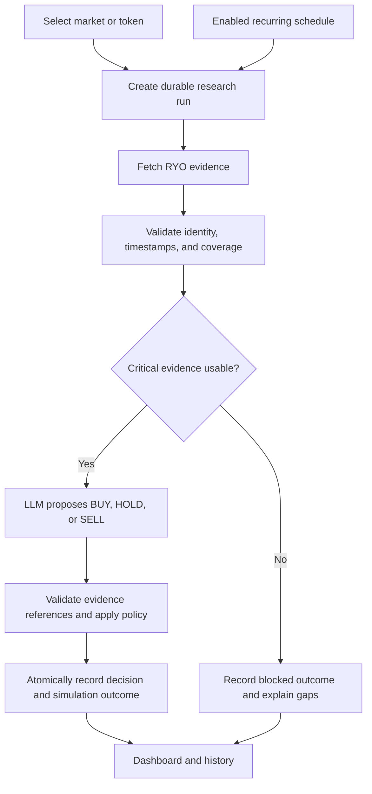
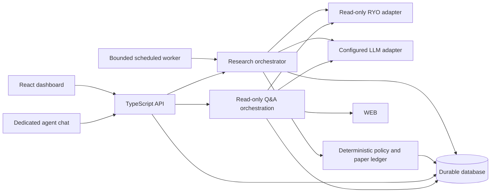

# TradeSense

### Analyse → Reason → Predict → Simulate → Visualize

**RYO-CHAN Hackathon 2026 · Track 01: Autonomous Agents · Track 02: Dashboards & Interfaces**

TradeSense is a proposed AI crypto-market analyst that scans markets, interprets evidence, explains a BUY / HOLD / SELL decision, and records the practice trade it would make. One dashboard connects market changes to the agent's explanation and simulated portfolio impact. A dedicated agent chat section lets users ask questions about the market and data derived from RYO-CHAN, with evidence-linked answers and follow-up questions.

> User chooses market/token → RYO tools fetch data → AI agent analyzes evidence → simulated decision → dashboard explains why

**Status — October 1, 2026: persisted market overview, the versioned multi-tool research pipeline, detailed saved tool timeline, offline recovery, responsive evidence workspace, comparable-run summaries, paper valuation, recurring scans, and hosted-provider boundaries are implemented; a full live run remains blocked by degraded RYO source data.** The dashboard has an explicit read-only `market_overview` refresh that persists an owned broad-market snapshot, age/freshness, coverage, warnings, provenance, and failed refresh attempts without changing a decision or paper portfolio. Each new decision run persists `analyze_token`, `deep_analysis`, `scan_market`, and `compare_tokens` evidence before Gemini receives the combined research packet. Every planned step also retains its role, sanitized arguments, status, attempt count, start/completion times, evidence link, provider status, and safe failure details. The TypeScript workspace contains a React landing page and application shell, responsive overview, analysis, portfolio, history, and agent-chat views, an Express API, a durable local SQLite ledger, fixture and live RYO research adapters, a configurable Gemini adapter, and a Tavily Search adapter restricted to additional chat context. The visual composition is an original implementation informed by the supplied frontend reference; its mock services, Google authentication, browser-owned provider controls, data, and media were not imported. Instant demo entry uses the existing anonymous prototype session and does not require Google. The dashboard derives price/change, decision, and simulation deltas only from compatible owned snapshots and values paper holdings with their newest saved `analyze_token` marks; missing marks make valuation partial or unavailable rather than zero. Every successful research step is committed before the next provider call, decisions and policy inputs are committed before simulation, and retries resume saved work without duplicating provider calls, paper fills, or completed chat research. Anonymous browser sessions isolate portfolios, runs, market overviews, history, conversations, schedules, linked-run access, and evidence citations. Recurring schedules start paused, require an operator enable flag, use durable unique token/time slots and worker leases, enforce cadence/watchlist/daily-run limits, prevent overlapping portfolio jobs, and let pause/cancel win atomically before simulation application. SQLite-backed HTTP, Gemini, and RYO operation counters enforce session and operator limits; chat has explicit conversation/message caps; graceful shutdown stops new scheduler ticks and waits for a running tick. A live RYO `analyze_token` call, one Tavily search, and one Gemini answer over combined saved evidence were verified separately, but RYO's later market-data failures still prevent a complete live-evidence paper decision. Real timestamped candle charts, deployment, and production authentication remain unfinished.

The official hackathon overview and MCP Builder Guide were checked on September 23, 2026. They confirm an October 3, 2026 at 23:59 JST deadline, a six-tool authenticated read-only research surface, and server-held practice trades. The deployed catalog remains authoritative and still requires a builder credential; model availability and live response fields beyond the public envelope have not been tested in this workspace.

## Contents

- [Problem and product](#problem-and-product)
- [Track fit and acceptance criteria](#track-fit-and-acceptance-criteria)
- [Scope](#scope)
- [Workflow and architecture](#workflow-and-architecture)
- [RYO integration](#ryo-integration)
- [Tavily web research](#tavily-web-research)
- [Agent decisions and evidence](#agent-decisions-and-evidence)
- [Simulation contract](#simulation-contract)
- [Dashboard](#dashboard)
- [Agent chat](#agent-chat)
- [Storage and recovery](#storage-and-recovery)
- [Proposed stack and layout](#proposed-stack-and-layout)
- [API contract](#api-contract)
- [Setup contract](#setup-contract)
- [Build milestones](#build-milestones)
- [Verification and troubleshooting](#verification-and-troubleshooting)
- [Demo and submission](#demo-and-submission)
- [Limitations and next steps](#limitations-and-next-steps)
- [Reference provenance](#reference-provenance)

## Problem and product

Crypto research is scattered across market metrics, price charts, token details, and safety checks. A signal alone does not tell a viewer what changed, how reliable the evidence is, or what action follows.

TradeSense ties these together in a single research run. A viewer should understand **what changed, why it matters, what the agent decided, and what prevented a trade** within 30 seconds.

Example journey:

> “Analyze this token, compare it with another candidate, explain the risks, and show the trade you would simulate.”

“Predict” means a time-bounded, uncertain outlook with an invalidation condition. It does not mean a guaranteed price target or a claim of profitable trading. The visible reasoning trail is a concise evidence-linked explanation, tool history, and policy outcome—not a transcript of private model deliberation.

## Track fit and acceptance criteria

| Track from the brief | TradeSense contribution | Evidence to demonstrate |
|---|---|---|
| 01 — Autonomous Agents | RYO research, LLM analysis, policy checks, durable practice-trade records | One complete run linking tool results to a decision and ledger event; replay and recovery without duplicate trades |
| 02 — Dashboards & Interfaces | Prioritized market overview, token cards, charts, risk, explanation, decision history, and dedicated agent chat | A viewer identifies the latest change, decision, supporting evidence, and risk within 30 seconds, then asks evidence-grounded follow-up questions |

Project acceptance gates, not independently verified judging rules:

- [ ] A market scan and a selected-token analysis use usable live RYO calls in one completed run. Authentication and one live analysis were verified, but current market-data responses are degraded.
- [x] Deep-analysis risk coverage and like-for-like comparison evidence are integrated into the versioned decision research plan; unavailable or partial deep-analysis coverage blocks BUY/SELL simulation and remains visible.
- [ ] Every completed decision cites persisted evidence and includes contrary evidence or missing information.
- [x] Fixture mode demonstrates deterministic BUY/HOLD/SELL accounting with explicit fees and adverse slippage.
- [x] A stale execution price prevents simulation and records the reason.
- [x] Run retries reuse persisted evidence/decisions, portfolio-version conflicts are blocked, and the database permits only one fill per decision; broader multi-process lease tests remain pending.
- [ ] Dashboard summary, chart data, explanation, and history all identify the same run and data mode.
- [x] The minimal first-screen summary and selectable history restore the same owned run, show its evidence time, decision, policy outcome, strongest risk, failure state, and replay verification, and survive refresh.
- [x] A minimal dedicated chat section answers fixture market and saved-decision questions with source timestamps and persisted evidence IDs. Richer LLM follow-ups remain pending.
- [x] Fixture chat persists its evidence before answering, resumes known model failures without repeating saved RYO/Tavily research, isolates owned records, and never applies a simulated trade. Richer fact/derivation labels remain pending.
- [x] A user can create, enable, pause, and permanently cancel a bounded owned schedule, with cadence and last/next slot visible; activation also requires the server operator gate.
- [ ] One fresh setup and one complete browser journey are verified before claiming a working MVP.

## Scope

### Must ship

One research agent, one selected market/network initially, a bounded token watchlist, one paper portfolio per demo session, and one dashboard with a dedicated agent chat section. Chat uses the same research tools and model adapter. Start with manual analysis and market Q&A, then add an opt-in recurring worker after persistence and recovery work.

The agent gathers market evidence, evaluates a token and its safety, compares candidates when requested, produces a structured decision, passes it through deterministic simulation rules, and saves the result. The UI presents market overview, analysis cards, price/volume charts, risk status, AI explanation, simulated decision, portfolio, prior decisions, and a conversational market-research area.

### Deferred

Real orders, wallet signing, deposits, swaps, leverage, shorts, derivatives, copy trading, multi-agent swarms, paid subscriptions, broad multi-chain support, and predictive-model training. Historical backtesting is separate from replaying a saved run and is deferred until timestamp and data coverage requirements are defined.

No trading keys or wallet connection are required. Real execution is outside this product's MVP scope.

## Workflow and architecture





The server owns orchestration, provider credentials, validated data, policy, and ledger writes. The browser renders authoritative run records. A failed live dependency must never cause an automatic switch to fixture data.

## RYO integration

The official MCP Builder Guide currently documents these six tools. The live authenticated catalog at `GET /api/mcp/tools` is authoritative:

| Tool | Intended role | Evidence to preserve |
|---|---|---|
| `scan_market` | Discover candidates and overview changes | Universe, filters, timestamp, ranking inputs, coverage |
| `analyze_token` | Inspect one token's market behavior | Stable token identity, metrics, units, price basis, observation times |
| `deep_analysis` | Comprehensive token evidence, including risks and optional profile/derivatives coverage | Market, technical, risk, coverage, preview-plan fields |
| `compare_tokens` | Compare selected candidates on the same basis | Token identities, matching periods/units, comparative metrics |
| `monitor_market_sentiment_shift` | Seven-day sentiment change | Observation dates, coverage, regime, explicit gaps |
| `market_overview` | Broad market context | Regime, totals, dominance, sentiment, breadth, movers |

The implemented server-side REST adapter posts a bare argument object to `/tools/{tool}/call`, authenticates with `RYO_MCP_KEY`, validates the public result envelope, and uses a 60-second timeout. New decision runs use research plan `selected-token-v2`: `analyze_token` supplies the selected-token price/metrics, `deep_analysis` supplies required risk coverage, `scan_market` supplies shortlist context, and `compare_tokens` compares the selection with BTC (or ETH when BTC is selected) for a swing intent. Calls are sequential and separately budgeted. Each valid response is persisted immediately; a failed retry skips already-saved tools and continues at the first missing step. Live `analyze_token` prices are normalized from `data.market.price_usd`; fixture prices remain supported at `data.price`. Safe provider failures retain a classified code and retryability without exposing credentials or raw payloads. Before enabling live mode, query the catalog, verify the builder credential/quota, and run the smallest real read-only call. Live mode requires both a RYO key and the Gemini adapter. The current live smoke command verifies only the bounded RYO `analyze_token` call; it does not invoke Gemini or modify the paper ledger.

On September 24, 2026, authenticated diagnostics separated the MCP gateway from its data dependencies. `GET /tools`, `/health`, and `/whoami` returned HTTP 200; health reported six tools, and the key reported `tools:read`, expiry in December 2026, and all 60 per-minute requests remaining. In contrast, `analyze_token` returned `couldn't analyze SOL right now`, `deep_analysis` reported unavailable current USD data, `scan_market` returned zero candidates with `status=unavailable`, and `market_overview` returned `status=partial` with null market cap, volume, dominance, sentiment, breadth, and movers. One valid SOL snapshot had succeeded earlier the same day. This evidence indicates an intermittent or degraded downstream market-data pipeline, not an unlaunched MCP service, invalid key, exhausted quota, or busy gateway. RYO does not disclose the failing upstream source in these responses, so the exact vendor or internal component remains unknown.

A September 28 UTC recheck reproduced the degradation across the full six-tool surface. Health, catalog, and identity still returned HTTP 200 with six tools and `tools:read`; `market_overview` returned a fresh `partial` live envelope and neutral regime but warned that sentiment, breadth, and movers were unavailable. `analyze_token` still could not analyze SOL, `deep_analysis` reported that current SOL/USD data was unavailable, `compare_tokens` lacked enough current USD observations, `scan_market` returned zero candidates with `status=unavailable`, and sentiment monitoring was unavailable. Provider rate-limit headers remained within 56–59 of 60 during the parallel diagnostic. The gateway and credential are working, but usable real token market data is still not flowing and no complete live decision is verified.

Normalize observations into evidence records containing an ID, run ID, tool, sanitized parameters, token/network identity, source timestamp, retrieval timestamp, units, normalized values, data mode, and a redacted raw-response reference/hash. Preserve failures and missing fields. A missing value is not zero; missing safety coverage is not a clean bill of health.

Use network plus contract/mint address where available; a ticker alone is ambiguous. Compare only compatible currencies and windows. Do not compare a 24-hour change with a 1-hour change as though they were equivalent.

Apply bounded timeouts, retries with backoff, caching with explicit expiry, and request limits. Cache hits retain original observation times. If RYO does not supply historical candles, explicitly show that limitation or verify and disclose an additional read-only data source; do not fabricate a chart from summary metrics.

## Tavily web research

Tavily is the selected web-access provider for current public context such as project announcements, protocol documentation, exchange notices, regulatory news, and explanations that RYO market tools do not cover. The user has a Tavily API key with a 1,000-credit allocation. Tavily's current Researcher plan advertises 1,000 credits per month; basic search costs 1 credit and advanced search costs 2 credits. Treat the account dashboard as authoritative because plan terms and remaining credits can change.

Tavily supplements RYO in **Ask TradeSense only**. It is never called by analysis runs, decisions, policy, or simulation. RYO remains the authoritative integration for token metrics, market scans, comparisons, and hackathon-specific evidence. A Tavily result is web evidence with its own source URL, title, published time when available, retrieval time, query, search depth, rank or score, and content snippet. Chat labels the returned links as Tavily web sources and keeps their evidence IDs alongside RYO citations.

The implemented MVP uses the Search API only: `basic` depth, at most 5 results, no answer synthesis, no images, and no raw-page content. Deterministic chat routing invokes it for questions about news, announcements, listings, regulation, incidents, or other explicit recent public developments. Price, volume, comparison, and saved-decision questions stay on RYO or persisted evidence. Extract and Crawl are disabled. Persist URLs and citations, but treat snippets as untrusted input that cannot change tool permissions, choose arbitrary follow-up URLs, or issue trades.

The server-side configuration contract is `TAVILY_API_KEY`, `TAVILY_BASE_URL=https://api.tavily.com`, `TAVILY_SEARCH_DEPTH=basic`, `TAVILY_MAX_RESULTS=5`, `TAVILY_TIMEOUT_MS=15000`, and `TAVILY_MONTHLY_CREDIT_CAP=1000`. The key stays server-side and outside logs, model prompts, browser bundles, and committed files. Before the single provider attempt, the server reserves one estimated credit in SQLite and rejects operations that would exceed the monthly cap. It records the query, settings, request ID, actual reported usage, status, and error code. The response is capped at 256 KB; source URLs are limited to public HTTP(S) links. A web-context answer must cite its Tavily evidence record, and the UI exposes the underlying source links. One one-credit live Tavily search was verified on September 24, 2026.

## Agent decisions and evidence

The selected hosted reasoning provider is Google Gemini through the official `@google/genai` SDK. The default hosted model ID is `gemini-3.5-flash-lite`, configurable through `LLM_MODEL` because model access can vary by project. The original `gemini-2.5-flash` selection returned a provider 404 for this new project on September 23, 2026; the recommended 3.6 Flash then remained unavailable through bounded retries because of provider demand. The stable low-latency 3.5 Flash-Lite model supports structured output and a free tier, making it the explicit prototype default. The adapter requests JSON structured output with minimal thinking at temperature `0.2`, limits output to 2,048 tokens, applies a 60-second per-attempt timeout, validates the result with the shared schemas, verifies every evidence ID, permits one repair attempt for an invalid structured response, and retries explicit 429/5xx responses with bounded backoff. Its sanitized request, response, settings, input hash, model ID, and prompt version are stored in `model_calls`.

`LLM_PROVIDER=fixture` keeps the deterministic offline adapter. `LLM_PROVIDER=gemini` requires `LLM_API_KEY` at server startup. Gemini can be paired with fixture RYO evidence first, which tests model behavior without requiring a RYO credential or presenting fixture data as live.

The LLM receives only normalized evidence and bounded context. It proposes the research decision; ordinary code validates evidence references, enforces policy, and sizes any simulated order.

| Decision field | Contract |
|---|---|
| `runId`, `tokenId`, `asOf` | Server-issued run, canonical token, evidence cutoff |
| `action` | `BUY`, `HOLD`, or `SELL` |
| `summary` | Short explanation of the decision |
| `supportingEvidence`, `counterEvidence` | Evidence IDs with concise interpretations |
| `risks`, `missingData` | Known flags, uncertainty, unavailable checks |
| `outlook` | Directional scenario, explicit horizon, invalidation condition |
| `confidence` | Low/medium/high evidence-strength label; not a calibrated probability |
| `model`, `promptVersion`, `policyVersion` | Reproducibility metadata |
| `policyOutcome` | Allowed/blocked, reason codes, and simulation outcome |

Validate every model output against a strict schema. Reject invented evidence IDs, nonfinite numbers, unexpected actions, and claims unsupported by the supplied evidence. One bounded repair attempt may be used; persistent invalid output yields a failed run, not a fabricated HOLD.

HOLD is a valid completed research decision. `BLOCKED` and `FAILED` describe run or policy outcomes. Preserve the proposed action when policy blocks it, but show “No simulated trade” prominently. Do not rewrite an unavailable analysis into an apparent successful HOLD.

Store the exact evidence snapshot, sanitized model request, model response, prompt/policy versions, generation settings, and simulation parameters. Replaying the saved decision through the same policy should reproduce ledger calculations. Rerunning a hosted LLM may produce a different answer; label that a new analysis rather than deterministic replay.

## Simulation contract

All balances, orders, fills, and returns are **simulated**. The initial product uses a long-only, unleveraged portfolio in one quote currency. These are proposed demo defaults, not investment recommendations:

| Parameter | Initial proposal |
|---|---|
| Starting cash | 10,000 virtual USD |
| BUY size | At most 5% of pre-trade equity per eligible decision |
| Per-token exposure | At most 20% of pre-trade equity after the proposed fill |
| SELL size | Entire available position for that token |
| Fee | 10 basis points of fill notional |
| Adverse slippage | 10 basis points on reference price |
| Execution reference freshness | At most 60 seconds old at simulation time |
| Recurring cadence | Proposed 5 minutes, subject to verified provider quotas |

Version these defaults and display active values. Recompute affordability including fees; round quantities down to supported precision. Reduce a BUY to available cash and exposure capacity, or skip with a reason if no valid quantity remains. SELL without holdings records `SKIPPED_NO_POSITION`. HOLD creates no fill and charges no fee.

For positive quantity `q`, reference price `p`, slippage fraction `s`, and fee fraction `f`:

- BUY fill price: `p × (1 + s)`; cash decreases by `q × fillPrice × (1 + f)`.
- SELL fill price: `p × (1 - s)`; cash increases by `q × fillPrice × (1 - f)`.
- BUY cost basis includes its fee. SELL realized P&L equals net sale proceeds minus the removed weighted-average cost basis.
- Unrealized P&L uses the latest explicitly timestamped mark; missing marks make valuation incomplete. Never silently value an unpriced holding at zero.

Use decimal arithmetic or scaled integers with explicit precision, not binary floating-point money calculations. Reject invalid prices, negative quantities, insufficient balances, unsupported tokens, and mismatched quote currencies.

Critical analysis and safety freshness windows must be configured after confirming source update cadence. Missing required windows, stale prices, unresolved high-severity safety findings, or insufficient safety coverage block simulated execution. This initial policy blocks both buys and sells when critical inputs fail; it does not pretend an unsafe or unpriced token could be sold.

Use only information observed by the decision cutoff. If a fresh execution reference is needed after analysis, store it separately with its timestamp and revalidate policy. The fill is a hypothetical quote-based assumption, not proof of exchange liquidity or execution. A run may end with a decision but a skipped trade when the execution quote is stale.

## Dashboard

Prioritize the latest change and its consequence over a wall of metrics:

| Area | Content |
|---|---|
| Header | Selected market/token, LIVE or FIXTURE label, as-of time, run control, schedule status |
| Decision summary | BUY/HOLD/SELL, trade applied/skipped/blocked, top reasons, strongest risk |
| Market overview | Supported universe, price/volume changes, candidate ranking and coverage |
| Token cards | Identity, price, change window, volume, liquidity when available, evidence links |
| Charts | Timestamped price/volume, explicit units/time range, simulated-fill markers |
| Safety panel | Findings, source, age, coverage, unknown/unavailable status |
| AI explanation | Supporting and contrary evidence, outlook, invalidation, uncertainty |
| Agent chat | Dedicated conversation area for market questions, RYO-derived insights, cited answers, and follow-ups |
| Paper portfolio | Virtual cash, holdings, realized/unrealized P&L, fees, valuation completeness |
| History drawer | Prior runs, decision changes, tool trace, policy version, simulation records |

Show “Changed since previous comparable run” with measured deltas and the evidence behind a changed decision. The comparison must use the same token identity, data mode, and compatible metric periods; otherwise explain why comparison is unavailable.

Support loading, partial data, no results, stale data, blocked analysis, provider errors, and completed runs. Keep the previous completed result visible with its timestamp while a new run is pending. Never mix a new chart with an old explanation without labeling both runs.

Use accessible contrast, keyboard navigation, readable mobile layouts, and text/icons alongside risk colors. A chart must have a textual summary. Expose detailed evidence on demand so the main screen remains understandable in 30 seconds.

The current responsive workspace implements an instant-entry landing screen, sidebar and mobile navigation, token selection cards, a persisted broad-market overview, selected-token snapshot, decision summary, evidence/risk details, safety coverage, paper portfolio, selectable owned history, failure/policy states, schedule controls, and read-only replay verification. The broad-market panel calls `market_overview` only from its explicit refresh button, keeps the newest owned successful snapshot visible when a later refresh fails, and renders missing metrics as unavailable. Its default freshness window is 300 seconds. The overview also includes a saved-run workflow for persisted evidence, AI decision, deterministic paper-policy outcome, and terminal audit record; it maps recorded FETCHING/ANALYZING/APPLYING failures to the corresponding step and explicitly states that exact live sub-stage telemetry is not streamed. Analysis and selected history records add a server-backed research-tool timeline with ordered roles, sanitized arguments, attempts, timestamps, elapsed time, provider/evidence status, evidence IDs, and safe failure details. Legacy runs without step records show an explicit unavailable state. Each existing view has a copyable `?view=` URL; reasoning and history links may include a selected `run` ID that is resolved only against the session's owned history. Reload and browser Back/Forward restore the view and permitted run context. The keyboard guide is available from the top bar or with `?`; `G` then `O/A/C/P/H` opens a workspace view, `C` opens chat, and `/` opens and focuses the chat composer. Shortcuts are suppressed in text fields and dialogs, and analysis/scheduling remain explicit button actions. `GET /api/dashboard?symbol=SOL` returns one synchronized owned summary containing the latest selected-token run, compatibility-checked previous-run deltas, portfolio marks/valuation, and chart availability. Comparable runs must share symbol, mode, available network/address identity, and metric window. The paper portfolio exposes virtual cash, total equity, realized and unrealized P&L, per-holding market value, mark age, complete/partial/unavailable valuation status, and a filterable recent simulation ledger with saved quantities, fill prices, fees, cash effects, and non-fill reasons. Dedicated analysis, portfolio, history, and chat views all use the existing server-owned data and actions. The fixture browser journey checks that the market overview, core decision, comparison, valuation, schedule, chat, and portfolio state restore after refresh. Because the API does not yet persist a timestamped candle series, the selected-token snapshot shows the saved reference price/change and an explicit “No candle series” state rather than drawing invented history.

## Agent chat

Dedicate a clearly labeled **Ask TradeSense** section of the webapp to conversational research. It should be accessible from the dashboard as a persistent panel or tab, with a full-width view on smaller screens. Include a message history, input box, suggested questions, selected market/token context, and visible LIVE/FIXTURE and freshness labels.

Example questions:

- “What changed in the market over the last 24 hours?”
- “What does RYO data show about this token's price and volume?”
- “Compare these two tokens and explain the main differences.”
- “Which safety flags were found, and which checks are unavailable?”
- “Why did the agent choose HOLD in this analysis?”
- “What evidence would change that outlook?”

The intended chat flow is:

1. Accept a question with explicit market/token context and, optionally, a selected prior run. Resolve ambiguous token names before fetching data.
2. Retrieve the user's permitted saved evidence. For current-market questions, fetch missing or stale information through the verified read-only RYO tools within configured limits. For questions about an earlier decision, use that decision's saved snapshot and label any newer comparison separately.
   When the question explicitly needs current public news or project context, add one bounded Tavily Search result set. Tavily never replaces RYO metrics and is never available to the decision or simulation flow.
3. Generate a concise answer that distinguishes source observations, calculated metrics, and AI interpretation. Ground market-specific claims in persisted evidence; derived numbers must retain their inputs, units, time window, and calculation method.
4. Validate citations and save the answer, evidence references, tool activity, and model/prompt metadata. Show clickable evidence details with source and observation time, plus limitations or uncertainty.
5. Preserve context for follow-ups. Make a token, network, run, or data-mode change explicit instead of silently answering about the previous selection.

General explanations such as “What is trading volume?” may be answered as educational context and labeled accordingly; they must not be presented as a current RYO finding. If a requested fact is absent, unsupported, or inaccessible, say what is missing. Old data may support a clearly labeled historical answer, never a claim to know the current market.

Chat performs research only. It may explain an existing BUY/HOLD/SELL decision or link to the separate analysis/simulation flow, but sending a message must not create fills, change balances, enable schedules, or modify policy. Chat fetches persist evidence under a separate research record with `purpose=chat`; they never enter the simulation application's `APPLYING` stage.

Use the same server-side model/RYO adapters, session checks, data-mode separation, and provider budgets as the rest of the product. Bound message length, conversation context, tool calls, output size, and concurrent requests. Market text and chat messages cannot override tool permissions. Validate cited evidence against the conversation owner's accessible records and render responses without executable HTML.

The implemented browser stores one anonymous session ID and its current conversation ID locally so refresh restores the same owned discussion. The chat view exposes the selected market, fixed conversation mode, available decision/run context, saved evidence age, message timestamps/status, source kind, retrieval time, evidence ID, response progress, and reusable follow-up prompts. The API binds portfolios, runs, conversations, linked runs, and cited evidence to that session. Chat messages move through `researching`, `answering`, `complete`, and `failed`; evidence is committed immediately after each completed research boundary. Retrying the same text/context with the same idempotency key reuses saved RYO and Tavily snapshots and resumes a known model failure. If a process interruption leaves a model call's external outcome ambiguous, the API returns `CHAT_MODEL_OUTCOME_UNKNOWN` instead of repeating it. Each answer retains its original evidence snapshot and timestamps.

The server retains at most 10 conversations per session and 100 stored messages per conversation by default. Each new question reserves room for its user and assistant messages; when the cap is reached, the API asks the user to start a new conversation. Records are retained for audit rather than silently deleted. The anonymous session header is a prototype ownership boundary, not production identity. A hosted deployment still needs authenticated, unguessable server-issued sessions, secure cookies, expiry/rotation, and CSRF protection where applicable.

## Storage and recovery

| Entity | Minimum persisted content |
|---|---|
| Sessions / portfolios | Ownership, data mode, initial cash, current ledger version |
| Runs | Input, idempotency key, request hash, mode, status, timestamps, cutoff, lease |
| Evidence / tool calls | Parameters, source, observation/retrieval times, values, duration, errors |
| Decisions | Validated proposal, rationale, evidence links, model/prompt/policy versions |
| Ledger events / fills | Run/decision ID, quantity, price, fees, cash and position deltas |
| Schedules | Owner, token/watchlist, enabled flag, cadence, next slot, lease and limits |
| Chat conversations / messages | Ownership, mode, ordered messages, per-message token/network/run context, idempotency key/input hash, status, answer, evidence citations, model/prompt metadata |
| Chat research / tool calls | `purpose=chat`, message ID, evidence snapshots, derived calculation inputs/methods, tool parameters/status/timestamps, usage and errors; no ledger application |

Run states: `QUEUED → FETCHING → ANALYZING → APPLYING → COMPLETED`, with explicit `BLOCKED`, `FAILED`, and `CANCELLED` outcomes. A completed run includes its simulation result even if no fill occurred.

Enforce a unique session/idempotency key and reject a changed body under the same key with `409`. Enforce one simulation application per decision. Use a database transaction and portfolio lock/version check for the ledger and completion record; retries must return the existing result.

The implemented run lifecycle stores its research-plan version and creates one durable `research_steps` row per planned call. A step moves through `PENDING`, `RUNNING`, `COMPLETED`, or `FAILED`; retry attempts update that same row, while completed evidence steps are reused. Provider calls remain outside database transactions. Gemini receives the four normalized observations together and must cite both the selected-token and deep-analysis records. The server persists the validated decision plus immutable policy input before applying its paper trade. Retrying the same idempotency key resumes from the first missing tool or latest saved boundary, while a completed retry returns the existing fill. Partial or unavailable deep-analysis coverage records `BLOCKED_SAFETY_COVERAGE` for BUY/SELL without changing the paper portfolio. The single-process server coalesces concurrent requests for the same key; a changed portfolio version becomes an explicit no-trade outcome.

Recurring scans are implemented with one durable job per schedule/token/time slot, unique slot constraints, expiring worker leases, and one in-flight job per owned portfolio. Schedules support one to three tokens, a 5-minute to 24-hour cadence, and a configurable 1–100 run daily cap. New schedules start paused; activation requires `SCHEDULER_ENABLED=true`. Pausing or cancelling stops queued jobs and is checked again inside the ledger transaction before application. Cancelled schedules are terminal. Missed intervals are skipped instead of creating an unbounded catch-up burst.

Except for health checks, the API permits 120 requests per session per UTC minute by default. Live RYO and Gemini operations reserve durable usage rows before the call, so failures also consume the configured budget. Defaults are 500 RYO operations per UTC day, 200 Gemini operations per UTC day, and 30 Gemini operations per session per UTC hour. Fixture adapters bypass provider budgets. On `SIGINT` or `SIGTERM`, the server stops accepting scheduler ticks, closes the HTTP listener, waits for the current tick to finish, and then closes SQLite; an interrupted durable slot can be recovered after its lease expires.

Separate fixture and live portfolios and conversations. Resetting a demo creates a new portfolio rather than deleting its audit trail. Session ownership protects runs, schedules, portfolios, conversations, messages, and their evidence; a record ID is not authentication. Conversation mode is fixed at creation. Bound retained chat history with a documented retention policy while preserving evidence references for retained answers.

## Proposed stack and layout

Use one TypeScript workspace to keep agent and UI contracts aligned. This is a starting design choice; package versions and runtime compatibility remain to be verified.

| Area | Proposal |
|---|---|
| Web | React, Vite, TypeScript; a focused chart library, with D3 only where useful |
| Server | Node.js, TypeScript, Express; orchestrator and scheduled worker |
| Shared contracts | Zod schemas, types, pure policy and simulation calculations |
| Persistence | SQLite with migrations for a single-process demo and durable local storage |
| Model | One verified provider adapter, initially selected from the user's candidates |
| Tests | Vitest for policy/integration; Playwright for the core dashboard journey |

```text
apps/
  web/                  # Dashboard and agent chat; local port 3000
  server/               # API, research/Q&A orchestration, scheduler; proposed port 4000
packages/
  core/                 # Shared schemas, policy, decimal accounting
  adapters/             # Verified RYO and model integrations
data/
  fixtures/             # Synthetic evidence and expected outcomes
migrations/             # Versioned database schema
docs/                   # Verified integration notes and demo evidence
AGENTS.md
HISTORY.md
README.md
```

The workspace now implements this layout. SQLite deployment requires a persistent writable volume and one supported writer topology. If hosting requires multiple instances or ephemeral storage, select durable PostgreSQL and adapt migrations before deployment; do not silently lose the ledger on redeploy.

## API contract

These are proposed application routes, not RYO endpoints:

| Route | Purpose |
|---|---|
| `GET /api/health` | Non-secret readiness and data mode |
| `GET /api/market` | Latest persisted market snapshot with age and coverage |
| `POST /api/market/refresh` | Explicitly fetch and persist one owned read-only RYO `market_overview`; no decision or ledger write |
| `POST /api/runs` | Validate token/market selection, optional comparison, and idempotency key; enqueue run |
| `GET /api/runs/:id` | Owned run, evidence, decision, and simulation status |
| `GET /api/runs/:id/replay` | Read-only deterministic policy replay for an owned completed run |
| `GET /api/history` | Paginated owned runs with mode/token filters |
| `GET /api/portfolio` | Owned paper portfolio and timestamped valuation |
| `GET /api/dashboard?symbol=<symbol>` | Synchronized latest run, compatible-run changes, timestamped paper valuation, and chart availability for one owned asset |
| `GET /api/schedules` | List owned schedules and their latest durable slot |
| `POST /api/schedules` | Create a bounded recurring analysis schedule |
| `PATCH /api/schedules/:id` | Enable, pause, or change an owned schedule within server limits |
| `POST /api/chat/conversations` | Create an owned conversation with fixed data mode and initial market/token context |
| `GET /api/chat/conversations` | List the session's conversations with pagination |
| `GET /api/chat/conversations/:id` | Retrieve owned context and paginated messages, statuses, and evidence references |
| `POST /api/chat/conversations/:id/messages` | Accept a bounded question, explicit context and optional run reference, plus idempotency key; enqueue research-only Q&A |

The server generates authoritative IDs and enforces limits. Return structured errors `{ code, message, requestId, retryable }`. Keep secrets and stack traces out of responses. Poll persisted state first; streaming is optional polish. Chat submission returns the persisted message/operation ID and status; poll the conversation to retrieve completion. Enforce conversation ownership and validate linked run/evidence access. Reusing a message idempotency key with different text or context returns `409`.

Except for `/api/health`, current API requests require `X-TradeSense-Session` containing a UUID. The browser creates and retains this identifier in local storage. Missing or malformed identifiers return `401 SESSION_REQUIRED`; inaccessible owned records return `404` without revealing whether another session owns them.

## Setup contract

Node.js 22.13 or newer and npm are required. From the repository root, install from the committed lockfile with `npm ci`, then use the implemented commands below. Fixture mode is the default and performs no RYO or hosted-model calls.

| Command | Current behavior |
|---|---|
| `npm ci` | Install from the committed lockfile after its initial creation |
| `npm run doctor` | Validate redacted configuration and local storage readiness; no inference |
| `npm run db:migrate` | Apply versioned schema changes without deleting history |
| `npm run dev` | Start web and API; schedules run only when explicitly enabled |
| `npm run lint` / `npm run typecheck` | Static checks |
| `npm test` | Offline policy, accounting, persistence, and adapter fixture checks |
| `npm run test:e2e` | Browser journey against isolated fixture data |
| `npm run smoke:live` | Bounded real RYO `analyze_token` request only; no model call or ledger write |
| `npm run replay -- --run-id <id>` | Recompute a saved decision's policy result from its immutable inputs, compare it with the stored outcome, and report without provider calls or portfolio mutation |
| `npm run build` / `npm run start` | Build and start the supported deployment |

The committed `.env.example` contains placeholder-only local settings:

```dotenv
DATA_MODE=fixture
PORT=4000
WEB_ORIGIN=http://localhost:3000
DATABASE_PATH=./data/tradesense.sqlite
RYO_MCP_URL=https://app-ryochan.com/api/mcp
RYO_MCP_KEY=
TAVILY_API_KEY=
TAVILY_BASE_URL=https://api.tavily.com
TAVILY_SEARCH_DEPTH=basic
TAVILY_MAX_RESULTS=5
TAVILY_TIMEOUT_MS=15000
TAVILY_MONTHLY_CREDIT_CAP=1000
LLM_PROVIDER=gemini
LLM_MODEL=gemini-3.5-flash-lite
LLM_API_KEY=
SIM_INITIAL_CASH=10000
SIM_FEE_BPS=10
SIM_SLIPPAGE_BPS=10
SIM_MAX_BUY_EQUITY_BPS=500
SIM_MAX_TOKEN_EXPOSURE_BPS=2000
SIM_MAX_PRICE_AGE_SECONDS=60
MARKET_OVERVIEW_MAX_AGE_SECONDS=300
SCHEDULER_ENABLED=false
SCHEDULER_TICK_MS=10000
SCHEDULER_LEASE_SECONDS=120
HTTP_REQUESTS_PER_SESSION_MINUTE=120
MODEL_CALLS_PER_SESSION_HOUR=30
RYO_DAILY_CALL_CAP=500
GEMINI_DAILY_CALL_CAP=200
CHAT_MAX_CONVERSATIONS_PER_SESSION=10
CHAT_MAX_MESSAGES_PER_CONVERSATION=100
```

With no `.env`, research and reasoning use deterministic fixtures and make no external requests. To test Gemini against fixture market evidence, copy `.env.example` to `.env`, keep `DATA_MODE=fixture`, and add the Gemini API key. Adding `TAVILY_API_KEY` enables one-credit Tavily searches only for chat questions matched by the public-context router; all other chat and every analysis run avoid Tavily. To enable live RYO research later, also set `DATA_MODE=live` and add `RYO_MCP_KEY`; live mode rejects missing configuration.

Load server configuration explicitly. Never place provider credentials in browser-exposed `VITE_*` variables, logs, screenshots, or committed files. Protect hosted model usage with session ownership, rate limits, and operator-configured cost/request caps. Live research may incur provider fees even though all trades are simulated; use configured access and spending authorization.

## Build milestones

This is the remaining ordered build plan. The official submission deadline checked on September 23, 2026 is October 3, 2026 at 23:59 JST.

| Milestone | Deliverable | Completion gate |
|---|---|---|
| 1 — Verify and scaffold | Official integration notes, workspaces, schemas, database, fixtures | Workspace and offline app complete; one real RYO call still required |
| 2 — Research path | RYO adapter, bounded Tavily search adapter, model adapter, saved evidence and decision | One live selected-token run with valid RYO and optional web citations |
| 3 — Simulation | Policy, decimal accounting, transactional ledger, recovery | Manual-run resume, stale/version blocks, unique fill, and deterministic replay pass offline; broader accounting cases remain |
| 4 — Dashboard and chat | Overview, cards, charts, risk, explanation, portfolio/history, and dedicated market Q&A | Responsive reference-informed workspace, run summary/history/replay, schedules, and chat recovery pass the fixture browser journey; real candle charts await persisted source data |
| 5 — Autonomy and hardening | Bounded recurring worker, pause/cancel, rate limits | Durable slots/leases, cancellation-before-application, HTTP/model/provider caps, chat bounds, and graceful worker shutdown pass offline |
| 6 — Demo readiness | Fresh setup, live evidence, failure demo, deployment plan | Clean fixture setup and automated browser rehearsal pass; runbook is written; current complete live run and deployment remain pending |

Prove the data integration before expanding the UI. If a tool is unavailable, preserve the limitation and revise scope transparently. Cut animations, extra pages, and advanced chart controls before evidence provenance, accurate accounting, or recovery.

## Verification and troubleshooting

Required behavioral checks during implementation:

- Stale/missing evidence, wrong token identity, mixed metric windows, and unknown safety coverage.
- Tool failures, quota responses, invalid model output, invented citations, and prompt injection in market text.
- Cash/quantity precision, fees/slippage, exposure caps, zero holdings on SELL, and incomplete valuation.
- Same request retry, changed input under an existing key, concurrent portfolio updates, and restart after decision persistence.
- Schedule overlap, disabling/cancelling near application, and live/fixture data separation.
- UI loading/error states, keyboard use, consistent run IDs, and a BUY → HOLD → SELL fixture journey.
- Chat evidence citations, derived calculations, follow-up context, token changes, historical versus current answers, and missing/stale-data responses.
- Chat ownership isolation, prompt injection, safe rendering, usage limits, duplicate-message/restart recovery, and proof that chat cannot write the paper ledger or enable schedules.
- A separately identified live smoke run using real RYO data and the selected model, without real orders.

| Symptom | Check first | Correct behavior |
|---|---|---|
| Empty market view | Actual provider coverage, parameters, quota, mode | Show no data or error; preserve prior snapshot with age |
| Missing chart | Candle availability, units, timestamps | Show unavailable; never invent candles |
| Decision cannot be parsed | Model output and schema validation | Bounded repair, then explicit failure |
| BUY blocked | Evidence age, safety coverage, cash, exposure | Show the specific policy reason |
| Duplicate simulated fill | Idempotency, unique constraints, transaction boundary | Stop application and fix ledger correctness |
| Portfolio disappears after restart | Database path, migrations, durable volume | Recover persisted state; never silently reinitialize cash |

Offline tests establish application behavior, not live RYO compatibility or predictive accuracy. Record exact verification outcomes in HISTORY.md.

## Demo and submission

The executable fixture walkthrough, failure checks, live-recovery gate, deployment preflight, and verified-claims list are in [docs/DEMO_RUNBOOK.md](docs/DEMO_RUNBOOK.md).

Suggested three-minute narrative, subject to official event rules:

1. **0:00–0:30:** Select a token and explain the two-track product.
2. **0:30–1:15:** Run analysis; reveal source timestamps, safety coverage, and comparison evidence.
3. **1:15–2:00:** Show the decision, opposing evidence, and the resulting paper trade or block.
4. **2:00–2:30:** Ask the chat “Why HOLD?” and open its cited evidence; show the saved decision history and replay result without duplicate fills.
5. **2:30–3:00:** Show schedule controls, an unavailable/stale-data state, and limitations.

Use clearly labeled fixtures to demonstrate specific edge cases; do not present them as live research. Keep a genuine live-run recording if access permits.

- [ ] Verify official deadline, eligibility, both-track submission rules, video format, and required RYO usage.
- [ ] Record actual app/repository/demo URLs only after they exist.
- [ ] Preserve tested commit, dependency versions, tool/schema references, model ID, prompt and policy versions.
- [ ] Document reused code, licenses, AI assistance, setup prerequisites, and provider access costs.
- [ ] Keep simulation labels and data timestamps visible in screenshots and recordings.
- [ ] Confirm hosted storage durability and worker availability before promising continuous scans.

## Limitations and next steps

TradeSense is a research and simulation prototype. Safety checks have limited coverage; model explanations can be wrong; a quote-based paper fill does not model real liquidity, routing, latency, or execution. Paper returns do not establish future performance. The project is not financial advice.

While RYO market data remains unavailable, the next implementation choice is a persisted candle-source contract, multi-conversation chat navigation, or clearer fact/derivation labels in explanations. Historical chart work requires a verified timestamped price/volume source and must not use Tavily as a market feed. A hosting plan can also be prepared without claiming deployment. When RYO recovers, rerun one complete four-tool live evidence → Gemini → paper-simulation validation using the runbook gate. The current visual shell is deliberately separated from provider and ledger logic so a later UI refinement can replace presentation components without changing the safety contracts.

## Reference provenance

This plan uses the user's TradeSense brief as the product scope. The following AgentPay documents were read only as structural references and remain unchanged:

- `/home/bryan/Desktop/AgentPay/README.md` — product plan, acceptance gates, architecture, setup, verification, demo.
- `/home/bryan/Desktop/AgentPay/AGENTS.md` — coding-agent workflow and implementation guidance.
- `/home/bryan/Desktop/AgentPay/HISTORY.md` — append-only action log and entry format.

AgentPay's integrations, deployments, credentials, action history, event rules, and authorizations do not apply to TradeSense.

Official sources checked September 23–24, 2026:

- [RYO-CHAN Hackathon overview](https://dev.ryobuild.com/hackathon)
- [RYO Builder MCP Guide](https://dev.ryobuild.com/docs/MCP-Builder-Guide.md)
- [Gemini 3.5 Flash-Lite model](https://ai.google.dev/gemini-api/docs/models/gemini-3.5-flash-lite)
- [Gemini structured outputs](https://ai.google.dev/gemini-api/docs/structured-output)
- [Gemini API pricing and free tier](https://ai.google.dev/gemini-api/docs/pricing)
- [Tavily chat and source-attribution example](https://docs.tavily.com/examples/use-cases/chat)
- [Tavily Search API reference](https://docs.tavily.com/documentation/api-reference/endpoint/search)
- [Tavily pricing and credit allocation](https://www.tavily.com/pricing)
- [Tavily basic versus advanced search credits](https://help.tavily.com/articles/6938147944-basic-vs-advanced-search-what-s-the-difference)
